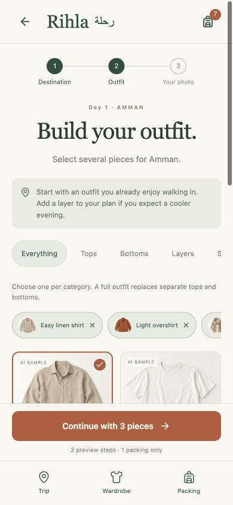

# Rihla — One Bag for Jordan
Mobile-first travel wardrobe planning for Amman, Petra and Wadi Rum, powered by YouCam Clothes V4.

[Hosted demo](https://rihla-jordan-essam.husheddegu256.chatgpt.site/) · [Judge guide](docs/JUDGE-TESTING.md) · [Project description](docs/PROJECT.md)

The hosted demo currently requires owner access; judge access is being arranged. The full source can be run locally with your own authorized YouCam key.



## Features
- Select multiple pieces, with one per category and full-outfit/top-bottom conflict handling.
- Sequential experimental clothing previews, using each completed result for the next garment.
- Resume delayed tasks, compare original/final photo, and pack selected pieces together.
- Accessories are packing-only. AI-generated sample garment photos are labeled.
- Deduplicated checklist, category gaps, browser-local planning, text export and print/PDF.

## Development
Use Node 24+; declared minimum 22.13.
```sh
npm run install:ci
npm run dev
```
Set your own authorized YOUCAM_API_KEY in an ignored .dev.vars file and restart for previews. Planning works without a key. Never commit .dev.vars or upload personal photos/credentials.
```sh
node --experimental-strip-types --test tests/*.test.mjs
npx tsc --noEmit
npm run build
```

## Integration
Server routes register/upload images, create Clothes V4 tasks and poll them. Later steps accept a signed prior-task ticket, verify completion, and pass the result URL as the next source. The key stays server-side. Each clothing step is a separate API generation and uses credits. See docs/mobile-v3.md for behavior and validation.

## Limits
Layering can change earlier details. Scarves are not rendered. Photos/results/queue progress are session-only; provider links expire. No live weather, retail checkout or guaranteed fit is included. Review YouCam's processing terms before submitting images.

## Deployment
The original private Site identity has been removed from .openai/hosting.json. Local development uses the portable runtime. To publish independently, configure your own hosting/project and encrypted secret; the original Site identifier is not an ownership grant. Do not commit deployment credentials.

## License
MIT — see LICENSE. Third-party packages retain their own licenses; see THIRD_PARTY_NOTICES.md.
